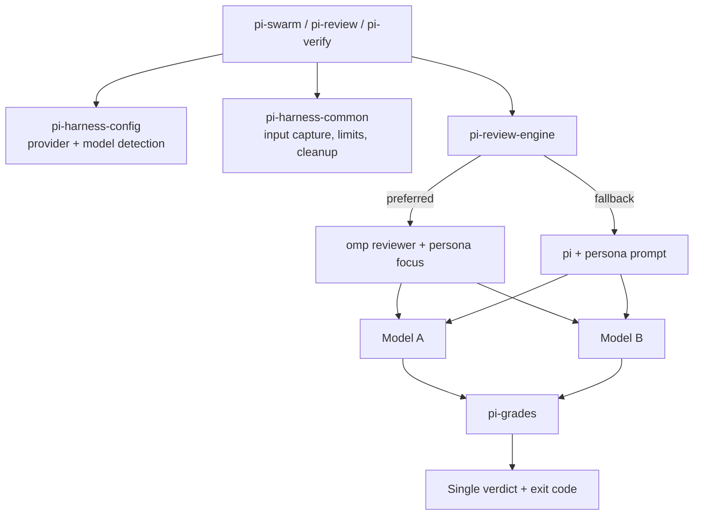

# Pi Harness

Cross-model AI code review harness: several review personas, run across
models from different providers in parallel, graded into one verdict.

> Portfolio piece. Source shown for review only; not licensed for use. See LICENSE.

## What it does

Pi Harness takes a diff (staged changes, a branch, or any `git diff`
command) or a set of whole files, and sends it to specialised reviewer
personas on two or more LLMs at once. Each review is graded on a five-tier
scale, and the run ends with a single pass/fail verdict and exit code, so a
developer or a CI step gets one answer instead of eight walls of text.

Three entry points:

- `pi-review` runs one persona against two models.
- `pi-swarm` runs every persona against every model (4 personas x 2 models
  = 8 reviews by default; `--quick` runs 2 x 2; `--files` reviews whole
  files instead of a diff).
- `pi-verify` checks that code matches a stated intent, with the model
  order swapped so the verifier is a different model family from the one
  that likely wrote the code.

## The problem

A single AI reviewer is unreliable. It invents issues, misses real bugs and
answers in a different format every time. No one model catches everything,
and "looks good to me" in free text is not a gate anyone can trust.

The harness answers that with three things:

1. **Cross-model validation.** The same change goes to models from
   different families (Anthropic, OpenAI, Google). Two independent models
   flagging the same function is a strong signal.
2. **Persona specialisation.** Correctness, adversarial, security and
   quality reviewers each look for one class of issue instead of one
   generic pass.
3. **Structured grading.** The grader looks for explicit signals (P0-P3
   priorities, `SEVERITY:` markers, verdict keywords). Absent proof is
   graded as unsure, never as verified.

## How it works

The entry scripts source four small bash libraries. `pi-harness-config`
detects which providers are configured (a LiteLLM proxy, an Anthropic key,
an OpenAI key) and picks a primary and secondary model. `pi-review-engine`
routes each review through [omp](https://github.com/can1357/oh-my-pi)
(preferred: its built-in reviewer prompt plus an appended persona focus) or
falls back to [Pi](https://pi.dev) with standalone persona prompts that
enforce a `SEVERITY:` output format. `pi-harness-common` captures the input
once to a temp file, enforces size limits and tracks child processes so
Ctrl-C cleans up every reviewer. Each reviewer runs in its own isolated
agent directory to avoid SQLite lock contention between parallel instances.
`pi-grades` strips code blocks from each output, scans it line by line with
negation handling, and assigns a grade; the worst grade sets the verdict.



### Grading

| Grade | Meaning | Passing? |
|-------|---------|----------|
| **PERFECT** | Clean signal, no findings | Yes |
| **VERIFIED** | Clean signal, only non-blocking findings | Yes |
| **PARTIAL** | No clear signal either way | No |
| **FEEDBACK** | Non-blocking findings, no clean signal | No |
| **FAILED** | P0, CRITICAL/HIGH, "incorrect" verdict or "Do not merge" | No |

Blocking signals always win: a P0 finding is FAILED regardless of any clean
signal in the same output. Exit codes: `0` all passed, `1` issues found,
`2` incomplete (reviewer failures or empty output).

### Personas

| Persona | Focus |
|---------|-------|
| **correctness** | Logic errors, off-by-one, null handling, races, missed edge cases |
| **adversarial** | Input validation gaps, error-handling holes, resource exhaustion, state corruption |
| **security** | OWASP Top 10, injection, auth gaps, secrets exposure, path traversal, SSRF |
| **quality** | Dead code, naming, duplication, complexity, testability |
| **verifier** | Intent against implementation, undocumented side effects, scope creep |

## Features

- Parallel multi-model, multi-persona review with a configurable cap
  (`PI_MAX_PARALLEL`, default 8) and per-reviewer timeout
  (`PI_REVIEW_TIMEOUT`, default 300 s).
- Provider auto-detection with overrides via a config file or
  `PI_HARNESS_MODELS`.
- Two engines (omp, Pi) behind one interface, with automatic fallback.
- Whole-file review mode that skips symlinks, files outside the working
  directory, secret-looking files (`.env`, `.pem`, `.key`, `credentials`)
  and binaries, so nothing sensitive is sent to a model API.
- Input size limits (`PI_MAX_INPUT_LINES`, `PI_MAX_INPUT_BYTES`).
- POSIX character classes in every regex for macOS and Linux portability.
- A summary block with grade distribution and one verdict line:

```
=== SWARM SUMMARY ===
Launched: 8 | Failed: 0 | Empty: 0
Grades: PERFECT=2 VERIFIED=3 PARTIAL=1 FEEDBACK=2 FAILED=0
Passing: 5/8
=== VERDICT: FEEDBACK -- 2 reviewer(s) found issues needing correction ===
```

## Stack

Bash (sourced libraries plus three entry scripts), git, the Pi and omp
coding-agent CLIs, and any of: a LiteLLM proxy, the Anthropic API, the
OpenAI API.

## Status

Active, v2.0. No automated test suite ships in this snapshot.

## Running it locally (for reviewers)

Needs bash, git, Pi or omp, and at least one provider key
(`ANTHROPIC_API_KEY`, `OPENAI_API_KEY`, or a LiteLLM entry in
`~/.pi/agent/models.json`). `setup/install.sh` detects providers, writes
`~/.config/pi-harness/config` and links the three scripts into
`~/.local/bin/`. Then, inside any git repo with staged changes:

```bash
pi-swarm --quick
```

## Layout

```
pi-harness-config     provider auto-detection, model selection
pi-harness-common     input capture, size limits, cleanup
pi-review-engine      omp/pi routing, persona validation, timeouts
pi-grades             five-tier grader
prompts/              persona prompts for the Pi fallback path
scripts/              pi-review, pi-swarm, pi-verify
setup/install.sh      setup script
```

## Author

Rico Rojas, rico@rtech-consulting.com, https://rico-rojas.com
